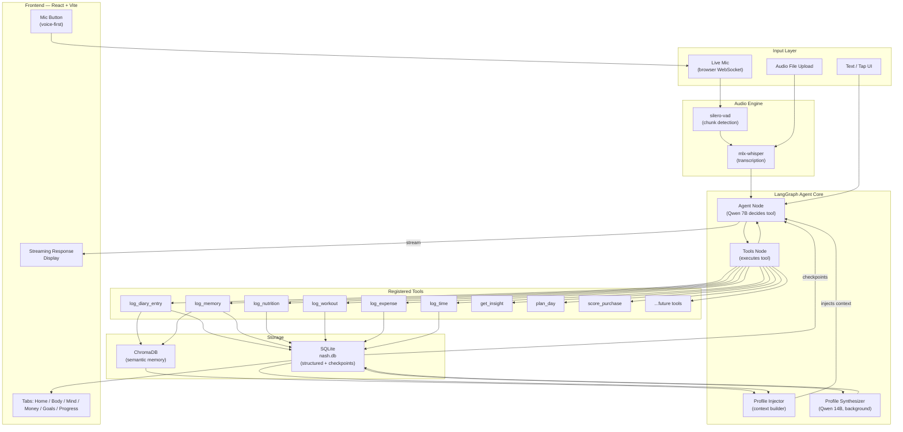
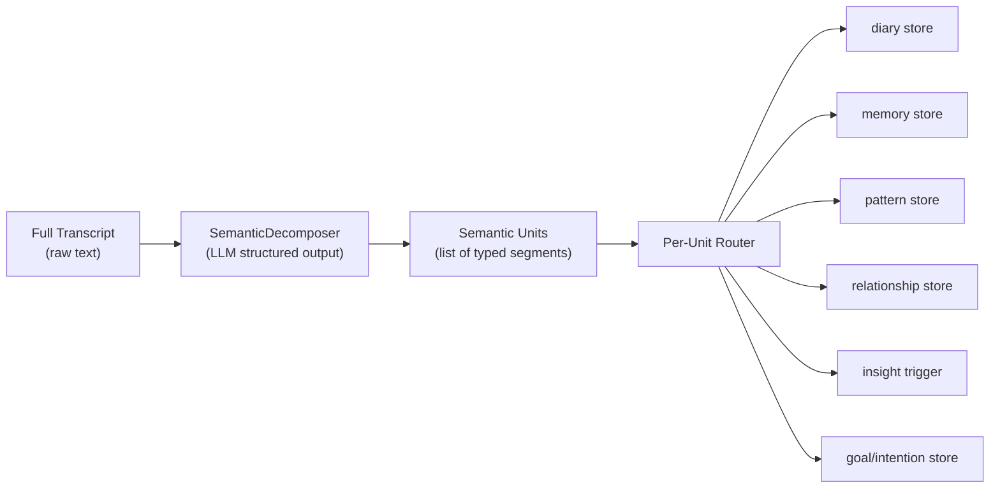

---

name: Nash Life Manager
overview: Build a fully local, privacy-first personal AI life manager called Nash that ingests voice/audio, builds a deep psychological profile, tracks nutrition/fitness/finances/time, and aligns daily actions with life goals — running on your M4 Mac with a LangGraph agent brain, no cloud dependencies, and a modular tab-based UI that grows with you.
todos:

- id: phase1-infra  
content: "Phase 1: Set up local infra — Ollama + models, Python project structure, FastAPI, aiosqlite, ChromaDB, mlx-whisper, LangGraph"  
status: pending
- id: phase1-audio
content: "Phase 1: Build audio engine — live mic + VAD (WebSocket) and file upload endpoint, both feeding MLX-Whisper"
status: pending
- id: phase1-agent
content: "Phase 1: Build LangGraph agent — ReAct graph with SqliteSaver, core tools, profile context injection, meta-transparency layer"
status: pending
- id: phase1-ui
content: "Phase 1: Build voice-first UI shell — React + Vite with mic button, transcript display, streaming response, Home tab with onboarding sprint"
status: pending
- id: phase2-memory
content: "Phase 2: Memory + Question engines — SemanticDecomposer, ChromaDB, ProfileSynthesizer, QuestionEngine with framework adaptation"
status: pending
- id: phase2-patterns
content: "Phase 2: Pattern + insight engine — hypothesis confidence markers, self-compassion reframing, question strategy adaptation"
status: pending
- id: phase3-work
content: "Phase 3: Work module — projects, daily to-dos, mood-based task sequencing, Flowmodoro sessions, distraction tracking, ultradian rhythm support"
status: pending
- id: phase4-goals
content: "Phase 4: Goals + Calendar + Time — implementation intentions, habit tracking (trend-based), weekly coherence report, daily planner"
status: pending
- id: phase5-body
content: "Phase 5: Body module — nutrition (voice logging, USDA DB, macros) + workout (progressive overload, daily plans)"
status: pending
- id: phase6-finance
content: "Phase 6: Finance module — expense logging, budget categories, shopping list LLM scoring"
status: pending
- id: phase7-dashboard
content: "Phase 7: Full dashboard — all tabs, Recharts visualizations, Meta Display in Mind tab"
status: pending
- id: phase8-macos
content: "Phase 8: Tauri macOS app wrapper"
status: pending
isProject: false

---

# Nash Life Manager — Architecture & Build Plan

## Session Delta (Apr 2, 2026)

- Home navigation was updated to card-style section access below Inicio.
- Daily questions generation issue was debugged end-to-end:
  - Symptom: `POST /api/questions/generate` took ~30s and returned empty list.
  - Root cause: parser rejected `tipo` values that included framework suffixes (example: `memory_archaeology (MI)`).
  - Fix: normalize `tipo`/`dominio` parser input before validation in `backend/agent/question_engine.py`.
- Operational note: features that depend on Ollama (`brief_summary`, `question_engine`, `profile_synthesize`, agent chat/retrieval) require `127.0.0.1:11434` to be reachable.

## Language

- **Audio input**: Spanish. MLX-Whisper transcribes directly in Spanish — `language="es"` parameter.
- **No translation anywhere**: The pipeline is Spanish end-to-end. Raw transcripts, stored semantic units, profile summaries, questions, and responses are all in Spanish. Translation is deliberately avoided because nuance in how Manuel phrases things in Spanish (hedging, specific word choices around emotions and relationships) is itself psychological data — translation would destroy it.
- **LLM**: Qwen 2.5 has strong native Spanish capability. System prompt instructs it to always respond in Spanish and process input in its original language.
- **UI**: All labels, buttons, messages, and generated text in Spanish.
- **Food logging**: LLM normalizes Spanish food names before USDA DB lookup (e.g., "pechuga de pollo" → "chicken breast") — translation only for DB lookup, not for storage.
- **Codebase, comments, variable names, and prompts written during development**: English only.

---

## Hardware Reality Check

- Apple M4, 16GB RAM
- **Primary model**: `qwen2.5:7b-instruct-q4_K_M` — fast tool calling, daily interaction (~4.5GB)
- **Synthesis model**: `qwen2.5:14b-instruct-q4_K_M` — deep profile synthesis, weekly jobs (~8.5GB, background only)
- **Transcription**: `mlx-whisper` — Apple Silicon native, fastest available on M4
- **Embeddings**: `nomic-embed-text` via Ollama — local, no sentence-transformers needed

---

## Agentic Architecture Decision — LangGraph vs Deep Agents vs SmolAgents

This is worth a real comparison. All three were evaluated.

### Deep Agents (LangChain's newest, v0.5.0a2 — March 2026)

Deep Agents is LangChain's answer to Claude Code and Cursor. It's a high-level "agent harness" built on top of LangGraph, designed for **open-ended, non-deterministic, long-running tasks** — think "research this topic and write a report" or "build this feature in a codebase." It provides planning tools (`write_todos`), a virtual filesystem for memory, shell access, and spawns subagents for parallelizing work. LangChain themselves define when to use it: *"when you want to build an autonomous agent for complex, non-deterministic tasks."*

**Why Deep Agents is wrong for Nash:**

- Nash's operations are NOT non-deterministic. They are well-defined: log a diary entry, log a workout set, retrieve insights. Deep Agents is overkill and adds unpredictability exactly where you need reliability.
- Its memory is a **virtual filesystem** (opaque text files). We need structured SQL for queries like "show macro totals for last 7 days" or "what's my best bench press in the last month." You can't run `GROUP BY` on a virtual filesystem.
- Still in alpha (`0.5.0a2`) — too unstable for a personal system you depend on daily.
- Its observability routes through **LangSmith (cloud)**. We are 100% local. No cloud, no tracing going out.
- Adding a new module (workout, finance) in Deep Agents means writing a new subagent. In LangGraph it means registering 3 new tool functions. LangGraph wins on simplicity.

### SmolAgents (HuggingFace)

Minimal, fast, native HuggingFace ecosystem. Uses **code generation as its action mechanism** — the LLM writes Python and executes it. This is clever for general agents but dangerous for a personal system: you don't want arbitrary code running against your finance and psychological data on every request. Also has weaker tool-calling reliability on smaller local models.

### LangGraph — Winner

LangGraph is the **runtime that Deep Agents itself runs on**. We're using the right layer of the stack — not so low that we're reinventing state management, not so high that we lose control.

- **Stateful graph**: each node is an explicit, auditable step. Every execution is inspectable.
- **SqliteSaver**: LangGraph checkpoints every state transition to `nash.db`. The full conversation and agent state is stored locally, in SQL, readable with any SQLite browser.
- **Tool calling via `langchain-ollama`**: Qwen 2.5 7B has strong structured tool calling. The LLM picks the right tool, we execute it, the result feeds back into context. Clean ReAct loop.
- **Adding a module = new tools + new tab**. The agent graph doesn't change.
- **Streaming and background jobs** work natively.
- Production-proven, stable, well-documented.

---

## System Architecture




---

## Data Architecture

All data lives in `~/.nash/` — one directory, fully portable, zero cloud.

### `nash.db` — SQLite (structured data + LangGraph checkpoints)

- `diary_entries` — id, timestamp, type (morning/night/spontaneous), raw_transcript, summary, domain_tags, energy_level
- `memories` — id, timestamp, topic, raw_transcript, life_period (childhood/adolescence/etc), chroma_id
- `nutrition_logs` — id, timestamp, food_name, weight_g, kcal, protein_g, carbs_g, fat_g
- `workout_sessions` — id, timestamp, notes
- `workout_sets` — id, session_id, exercise_name, muscle_group, weight_kg, reps, set_number
- `exercise_records` — id, exercise_name, best_weight_kg, best_reps, last_performed (progressive overload tracking)
- `expense_logs` — id, timestamp, amount, currency, category, description, raw_input
- `budget_categories` — id, name, monthly_limit, current_spent
- `shopping_list` — id, item, priority, estimated_cost, worth_score, reasoning, added_date
- `time_logs` — id, timestamp, activity, duration_min, category
- `projects` — id, name, description, status, goal_id, deadline, created_at
- `tasks` — id, project_id, title, cognitive_demand (low/medium/high), estimated_duration_min, status, due_date, priority
- `work_sessions` — id, task_id, started_at, ended_at, focus_quality (1–5), notes, distraction_count
- `distraction_events` — id, session_id, timestamp, distraction_type, pre_distraction_context
- `daily_todos` — id, date, task_id, position, completed, notes
- `implementation_intentions` — id, goal_id, situation_trigger, planned_response, created_at
- `goals` — id, domain, description, target_date, status, key_results
- `habits` — id, name, target_frequency, current_streak, last_done
- `profile_summaries` — id, domain, summary_text, last_updated (used as LLM context)
- `insights` — id, timestamp, content, related_domains, was_read

### `nash_vectors/` — ChromaDB (semantic memory)

- Collection `memories` — embeddings of diary entries + stories for "what do I know about Nash's X?" retrieval
- Collection `insights` — generated insights indexed by theme
- Collection `semantic_units` — individual extracted segments from multi-topic entries (see below)
- Queried via `nomic-embed-text` (Ollama) at retrieval time, no external API

---

## Multi-Topic Entry Handling — Semantic Decomposition

A single voice entry will routinely contain multiple threads: a childhood memory, a pattern recognition, a relationship reflection, a daily intention. The system must not collapse this into one bucket. This is the most important data fidelity problem in the architecture.

### The Decomposition Pipeline

After transcription, before the LangGraph agent does anything else, a **SemanticDecomposer node** runs a structured extraction call against the full transcript. It uses Qwen 7B with a structured output schema to extract all semantic units present:




Each extracted unit contains:

- `type` — one of: `memory`, `pattern_connection`, `relationship_reflection`, `diary_feeling`, `intention`, `insight`, `trauma_reference`, `goal_mention`, `behavior_observation`
- `content` — the verbatim or paraphrased segment
- `life_period` — `childhood`, `adolescence`, `youth`, `present`, `unspecified`
- `age_referenced` — estimated age if mentioned
- `topics` — list of tags (e.g. `["father", "abandonment", "work_approval"]`)
- `emotional_valence` — `positive`, `negative`, `conflicted`, `neutral`
- `domains` — which profile domains this touches (`identity`, `relationships`, `patterns`, etc.)
- `insight_potential` — `low`, `medium`, `high` (triggers profile update if high)

The whole transcript is also stored as a `diary_entries` row so context is never lost. The units are stored separately in `semantic_units` table and embedded individually in ChromaDB. This means a future query like "what do I know about Manuel's relationship with his father?" retrieves the actual memory unit, not a diluted full-entry embedding.

### New table: `semantic_units`

- id, diary_entry_id, type, content, life_period, age_referenced, topics (JSON), emotional_valence, domains (JSON), insight_potential, chroma_id, timestamp

---

## Memory Model — Context Assembly

Every LLM call builds context in priority order, targeting ~4000 tokens total (Qwen 7B context window is 32k, so plenty of room):

1. **System prompt** (~400 tokens) — Nash's personality, instruction to avoid generic advice, tone
2. **Core profile** (~700 tokens) — from `profile_summaries` table, domains: identity, patterns, sabotage, goals
3. **Recent activity** (~800 tokens) — last 3 diary entries + today's logs (nutrition, workout, time)
4. **Semantic retrieval** (~500 tokens) — top-3 ChromaDB hits relevant to current message
5. **Conversation history** (~800 tokens) — LangGraph checkpoint, last N turns from `thread_id`
6. **Current input** — the transcribed message

Profile updates are triggered in the background when: 5+ new diary entries since last synthesis, or a memory entry is tagged as "significant" by the agent.

---

## Profile Storage (No Obsidian)

The psychological profile lives entirely in `profile_summaries` table with these domain rows:

- `identity` — core personality traits, self-image, values
- `patterns` — behavioral patterns, triggers, cycles
- `sabotage` — auto-sabotage mechanisms, toxic patterns, addictions
- `strengths` — performance mechanisms, what makes Nash focus/calm/execute
- `relationships` — attachment style, family dynamics, recurring relationship themes
- `narrative` — life story arc, how Nash frames his own history
- `goals` — life goals and their emotional why

The ProfileSynthesizer (Qwen 14B, background) reads all recent entries and rewrites the relevant domain rows. The UI has a "Mind" tab where you can read these summaries.

### Two-Track Profile Architecture

The profile operates on two parallel tracks that are never merged blindly:

**Track 1 — Declared Truths**: Things Manuel explicitly states about himself ("I know I struggle with abandonment", "I'm a perfectionist"). Stored verbatim with `source: declared`, high initial weight. These are respected but not automatically accepted as ground truth — people hold protective or inaccurate self-narratives. They are flagged when behavioral evidence contradicts them.

**Track 2 — Behavioral Evidence**: Things the system observes across diary entries, distraction logs, work sessions, question answers, and semantic units. These are inferred, tracked over time, and promoted from `emerging` → `developing` → `established` only with repeated, consistent signal.

**Discrepancy Detection**: When Track 2 evidence contradicts a Track 1 declaration, Nash surfaces it gently: "You've described yourself as lazy, but your work logs show 3.8 hours of focused work today, and this has happened 9 times in the last 2 weeks. What do you make of that?"

**New table: `profile_facts`**

- id, domain, statement, fact_type (`declared` | `behavioral` | `inferred` | `contradicted`), source_type, evidence_count, confidence (`emerging` | `developing` | `established`), weight (0.0–1.0), contradicts_fact_id (FK, nullable), created_at, last_updated

### Audio Storage

All audio entries saved to `~/.nash/audio/` at **16kHz mono, OGG/Opus format** (~4KB/sec, ~1MB per 4-minute entry). This is the minimum quality needed for accurate Whisper transcription — no quality loss for speech, dramatically smaller files. Both raw audio and its transcript are always preserved, so if the architecture changes, no data is ever lost. File naming: `{timestamp}_{entry_type}.ogg`.

---

## Daily Discovery Question Engine

This is the second most important system in Nash after the profile itself. Generic questions produce generic answers. The goal is to surface things you don't know you know about yourself — and to do it with the precision of a good therapist, not a life coach app.

### Research Foundation

The question engine is built on five evidence-based frameworks, each selected for a specific purpose:

- **Motivational Interviewing (MI)** — open-ended "what/how" questions that build self-awareness without triggering defensiveness. 75% more effective than direct advice-giving in behavior change meta-analyses. Used for discovery and ambivalence surfacing.
- **Solution-Focused Brief Therapy (SFBT)** — exception questions ("when did the problem NOT happen?") and scaling questions ("0-10: how aligned does today feel with your goals? What would one step higher look like?"). 59% reduction in psychosocial outcomes in 72-study meta-analysis. Used for pattern interruption and habit building.
- **Internal Family Systems (IFS)** — parts work questions that surface internal conflicts without resistance: "what part of you is choosing distraction right now, and what is it protecting you from?" Evidence-based for PTSD, depression, chronic pain (2025 scoping review). Used for surfacing sabotage mechanisms and emotional drivers.
- **Experience Sampling Method (ESM/EMA)** — the academic gold standard for idiographic self-knowledge. Short, context-anchored questions asked at scheduled moments (morning/evening) and random moments. Reveals patterns invisible to retrospective reflection. Used for the structural rhythm of daily check-ins.
- **ABC Behavioral Chain (CBT)** — Antecedent → Behavior → Consequence chains. Asks about the 60 seconds before a problematic behavior, not the behavior itself. Used for habit pattern detection ("last time you opened Instagram when you were supposed to be working — what happened right before?").

### Question Taxonomy

Questions rotate across 7 types, never repeating the same framing within 30 days, weighted toward domains with the least recent data:

- **Type 1 — Memory Archaeology**: surfaces formative experiences. "Who was the first person that made you feel like your effort wasn't enough? What was the situation?"
- **Type 2 — Exception** (SFBT): finds when the problem doesn't occur — gold for habit change. Profile knows you struggle with morning routines → "Tell me about a morning recently where you got up when you wanted to. What was different the night before?"
- **Type 3 — Scaling** (SFBT): quick quantitative + narrative. "0 to 10: how much are you living according to your own standards today? What would moving one point higher require?"
- **Type 4 — Parts Work** (IFS): surfaces internal conflict. "When you say you want to work more but keep getting distracted — what does the part that chooses distraction feel like in your body? What is it trying to protect you from?"
- **Type 5 — Behavioral Chain** (ABC/CBT): traces antecedents. "Last time you procrastinated on something important — walk me through the 3 minutes before you stopped. What triggered it?"
- **Type 6 — Future Self** (goal alignment): tests coherence between present and stated goals. "If the version of you from 3 years from now could send you one message about this week, what would it say?"
- **Type 7 — Contrast** (MI + CIA elicitation): uses comparison to reveal values without direct interrogation. "You've said DJing matters a lot to you. When you compare the hours you've put into it this month vs something you did out of obligation, what do you notice?"

### How Questions Are Generated

Questions are NOT static prompts. Every morning, the QuestionEngine runs a generation call:

1. Reads current `profile_summaries` — which domains are thin? which patterns are flagged but unconfirmed?
2. Reads last 7 days of `semantic_units` — what themes came up? what was emotionally charged?
3. Checks `asked_questions` table — what was asked in last 30 days? what got a rich answer vs a short deflection?
4. Reads today's context: day of week, energy level from last diary entry, any notable events logged
5. LLM generates 5 targeted questions using the taxonomy above, weighted by domain gaps and recent themes

The result is 5 questions that feel eerily specific — because they are. The system knows you mentioned your girlfriend twice this week with conflicted valence and hasn't asked you anything about that relationship in 12 days.

### Answer Handling

Answers to daily questions are voice-first (tap the question, speak). The response goes through the same SemanticDecomposer pipeline. Answers are stored in `daily_question_answers` table and feed directly into the profile synthesis cycle. A rich answer to a Type 4 (parts work) question can immediately update the `sabotage` profile domain.

### New tables:

- `asked_questions` — id, timestamp, question_text, question_type, domains_targeted, answer_entry_id
- `daily_question_answers` — id, question_id, raw_transcript, semantic_units_extracted (JSON), answered_at

### Emotional Safety Gate

Before serving a Type 1 (Memory Archaeology) or Type 4 (Parts Work) question, the system checks the last diary entry's emotional valence. If it's strongly negative or the user is in a destabilized state (detectable from recent entries), it routes to a Type 3 (Scaling) or Type 6 (Future Self) question instead — lighter touch, same data value. You don't dig into trauma when someone is already overwhelmed.

---

## App Tabs (UI Structure)

```
[ Home ] [ Body ] [ Mind ] [ Money ] [ Goals ] [ Progress ]
```

- **Home** — voice mic button (primary), 5 daily discovery questions (tap to answer with voice), today's summary card, recent AI response, quick status (sleep, mood from diary)
- **Body** — two sub-tabs:
  - *Nutrition*: today's macros bar, food log list, weekly chart
  - *Workout*: today's plan, log session, exercise history, PR tracker
- **Mind** — psychological profile viewer, insights feed, pattern detection alerts
- **Money** — budget category cards (remaining/limit), expense timeline, shopping list
- **Goals** — life goals list with key results, habit streaks, weekly coherence report
- **Progress** — time allocation chart, project completion bars, habit calendar heatmap

New modules plug in as a new tab + new tools registered with the agent. No rewiring.

---

## Tech Stack

### Backend

- **Python 3.11+**
- **FastAPI** — REST + WebSocket
- **LangGraph** (`langgraph>=0.2`) + `langchain-ollama` — agent brain
- **Ollama** — local LLM runner (`brew install ollama`)
- **mlx-whisper** — Apple Silicon transcription
- `silero-vad` + `sounddevice` — live mic VAD chunking
- **aiosqlite** — async SQLite
- **ChromaDB** (embedded mode) — no separate server

### Frontend

- **React + Vite**
- **Tailwind CSS** + **shadcn/ui** — clean, modern components
- **TanStack Query** — data sync
- **Recharts** — all visualizations

### Future macOS App

- **Tauri** — Rust shell wrapping the existing React frontend. Zero rewrite. Native mic permissions, menu bar, offline-first.

---

## Project File Structure

```
nash_life_manager/
├── backend/
│   ├── main.py                  # FastAPI app
│   ├── agent/
│   │   ├── graph.py             # LangGraph graph definition
│   │   ├── tools/
│   │   │   ├── diary.py
│   │   │   ├── memory.py
│   │   │   ├── work.py          # projects, tasks, sessions, distractions
│   │   │   ├── nutrition.py
│   │   │   ├── workout.py
│   │   │   ├── finance.py
│   │   │   ├── time_tracker.py
│   │   │   └── goals.py
│   │   └── profile.py           # profile context builder + synthesizer
│   ├── audio/
│   │   ├── transcriber.py       # mlx-whisper wrapper
│   │   └── vad.py               # silero-vad chunker
│   └── db/
│       ├── schema.py            # SQLite table definitions
│       └── chroma.py            # ChromaDB client
├── frontend/
│   ├── src/
│   │   ├── components/
│   │   │   ├── MicButton.tsx
│   │   │   ├── StreamResponse.tsx
│   │   │   └── tabs/
│   │   │       ├── Home.tsx
│   │   │       ├── Work.tsx     # projects, tasks, Flowmodoro, distraction log
│   │   │       ├── Body.tsx
│   │   │       ├── Mind.tsx     # profile, insights, Meta Display
│   │   │       ├── Money.tsx
│   │   │       ├── Goals.tsx
│   │   │       └── Progress.tsx
│   └── ...
├── data/                        # ~/.nash/ symlink target
│   ├── nash.db
│   └── nash_vectors/
└── requirements.txt
```

---

## Research Validity Check

Before building, here is an honest assessment of every major component of this system against published research. Sources cited are peer-reviewed or well-replicated empirical work.

---

### VALIDATED — Things the research strongly supports

**Voice-first input**
Research (Fabla, 2025 — Behavior Research Methods) shows voice diary methods yield more than double the mean daily language volume of text-entry diaries. Speaking at 120–150 wpm vs 40 wpm typing means a 5-minute voice entry captures 6–10x more content. Critically, linguistic markers for emotional states (depression, anxiety) are significantly more detectable in voice vs text. Voice also outpaces the brain's self-censoring mechanism — people express things in speech they would edit in writing. This is one of the strongest architectural decisions in the plan.

**Adaptive AI-assisted reflection (with a critical caveat)**
The Reflective Agency Framework (AAAI/MIT, 2025) validates AI-mediated journaling for self-awareness improvement. AI can identify behavioral patterns, emotional triggers, and goal-behavior inconsistencies at scale that humans miss. The ExploreSelf study (arxiv 2409.09662) shows LLM-generated adaptive questions outperform predetermined question sets. However — the most important finding: *over-automation erodes user agency*. The best systems position AI as "a quiet companion, not a guide." Nash must help you discover what you want to do, not tell you what to do. This is a design philosophy constraint, not just a feature choice.

**Multi-topic semantic decomposition**
IBM Research (Neural Topic Modeling of Psychotherapy Sessions, AAAI 2023) and clinical NLP research confirm that treating a single transcript as a monolithic entry destroys signal. Topic segmentation at the semantic unit level, not the entry level, is the standard in clinical transcript processing. The TreeSeg approach (arxiv 2407.12028) validates hierarchical segmentation of large transcripts. Our SemanticDecomposer node is architecturally sound.

**Question taxonomy (MI + SFBT + IFS + ABC)**
Each framework is independently validated:

- Motivational Interviewing: outperforms advice-giving in ~75% of behavior change studies (NCBI meta-analysis)
- SFBT exception + scaling questions: 59% psychosocial improvement across 72 studies
- IFS parts work: evidence-based for PTSD, depression, chronic pain (2025 RCT, 2025 scoping review)
- ABC behavioral chain: foundational to CBT, extensively validated
- ESM/EMA: academic gold standard for idiographic self-knowledge (Csikszentmihalyi)

**Implementation intentions (currently missing — adding)**
Gollwitzer's if-then planning has one of the highest effect sizes of any single habit intervention: d = 0.65 across 94 independent studies. This is bigger than most therapy outcomes. If-then format: "When I wake up at 7am and feel like staying in bed, I will immediately put my feet on the floor and stand up." This needs to be a first-class feature in the Goals/Calendar module.

**Specific, challenging goals (Locke & Latham)**
90% of studies show specific+difficult goals outperform vague goals. Difficult goals produce 250% higher performance than easy goals when feedback is present. The Goals module should push back on vague inputs ("I want to be healthier") and require specific measurable targets.

**Continuous self-monitoring over time**
A 12-month RCT found continuous self-monitors (6+ months) showed significantly higher behavioral self-regulation and lower problematic eating vs non-continuous monitors. The key word is *continuous* — the system must support low-friction daily entry, not comprehensive logging. Voice makes this viable.

**Privacy-first local architecture**
App abandonment research (PMC 2024) identifies privacy concerns as one of the 6 primary abandonment drivers. Users explicitly quit apps citing data security fears. 100% local architecture eliminates this failure mode entirely.

---

### RISK AREAS — What the research says we must design against

**The 70% abandonment cliff**
Research: 70% of users quit self-tracking apps within 100 days. 80% quit productivity apps within 3 weeks. The Week 20 Problem is well-documented in fitness app research. Root causes: loss of motivation, perceived data uselessness, feature overwhelm, technical friction. This is the single biggest risk for Nash.

Mitigations already in the plan:

- Phased module activation (don't dump everything on day 1)
- Voice-first (lowest friction input method)
- Adaptive questions (system evolves, doesn't get stale)

Mitigations to add to the plan:

- **First-week insight guarantee**: the system must generate at least one genuinely surprising, specific insight within the first 7 days. If it doesn't, the user concludes the system is useless and quits. This means seeding the profile actively in Phase 1 onboarding.
- **Concrete outcome tracking**: show real-world changes, not app activity. Not "you have a 12-day streak" but "your average wake-up time moved from 9:15am to 8:30am over the last 3 weeks." Behavior change research (ENGAGE framework, 2025) shows concrete outcomes retain users; activity metrics don't.
- **Progressive module unlock**: Body tab visible but locked behind "complete 5 diary entries" or similar. This prevents overwhelm and creates early engagement goals.

**Feature creep / cognitive paralysis**
The Paradox of Choice is directly relevant. Apps with more features have lower sustained engagement. Our plan has 6 tabs, each with sub-features. The research prescription: make the default experience minimal and let users pull complexity toward them, not push it.

Design constraint: the Home tab must be completable in under 60 seconds on any given day. One mic tap, one daily question answer, done. Depth is available but never required.

**App engagement vs real behavior change (SDT critique)**
This is the most philosophically important finding. Self-Determination Theory (Deci & Ryan, 35+ years of research) shows that apps optimizing for engagement with the app itself undermine the actual behavior change goal. Streaks, points, and gamification create app-dependency rather than internalizing the behavior. The goal is for Nash to eventually become *less necessary* as Manuel builds autonomous habits — not to create dependence on daily use.

Design constraint: no streak anxiety mechanics. No "you broke your streak" guilt. Progress is visualized as longitudinal trends, not consecutive-day counters.

**Personality change is slow and modest**
Nature Reviews Psychology (2024): personality change through targeted interventions has a mean effect size of d = 0.22 (small-medium). 6-month therapy studies show "remarkably high differential stability" — patterns change much slower than apps suggest. *Merely wanting to change is only weakly related to actual change — interventions are necessary.*

This means Nash must:

1. Set honest expectations. The profile won't transform in a month.
2. Celebrate small, real changes (d = 0.22 is still meaningful and clinically significant).
3. Flag when a hypothesis about a pattern is tentative vs well-evidenced ("This appears in 3 entries. More data needed.").
4. Not generate confident psychological conclusions from thin data.

**Psychological framework lock-in**
You raised this explicitly: IFS, SFBT, MI — these may not fit best for you. This is empirically correct. Different therapeutic modalities work differently for different people, and there's no consensus on which is universally superior. The question taxonomy and profile frameworks should be treated as v1 defaults, not dogma. The plan should include a framework for swapping or weighting question types based on what has produced rich answers vs deflections over time. The `asked_questions` table already tracks answer richness — we should use that signal to adapt the question strategy.

**Food logging accuracy and friction**
Research: current food logging methods result in low adherence and inaccurate nutritional summaries. A 2025 multimodal study (SnappyMeal) found voice + follow-up questions = best accuracy + adherence combination. The USDA food database must be local and fast; slow lookups are a major abandonment driver.

---

### MODIFICATIONS TO THE PLAN

Based on this review, four things change:

**1. Add Implementation Intentions to Goals/Calendar module**
When a goal is set, Nash runs a follow-up: "Now let's make this real. Complete this sentence: When [specific situation], I will [specific action]." This is stored as an `implementation_intention` and surfaced as a context cue at the relevant moment (morning diary).

**2. Add Onboarding Insight Sprint to Phase 1**
The first 7 days need an accelerated onboarding mode: 10 structured questions across the first 3 sessions (not 5 per day) that rapidly seed the profile. The goal is to get to a first meaningful insight within 48-72 hours. This is the hook that determines long-term retention.

**3. Add Hypothesis Confidence Markers to insights**
Every generated insight carries a confidence annotation: "Emerging (2–3 data points)" / "Developing (4–8 data points)" / "Established (9+ data points, recurring across domains)." This is both epistemically honest and actually more persuasive — a well-evidenced pattern hits harder than a speculative one.

**4. Add Question Strategy Adaptation**
The QuestionEngine tracks not just what was asked but the richness of the response (word count, emotional content, new information added). Over time, it weights toward question types and framings that produce richer responses for this specific person. This is the mechanism for not being locked into any single framework.

**New table: `implementation_intentions`** — id, goal_id, situation_trigger, planned_response, created_at, last_triggered

**Updated `asked_questions`** — add `response_richness_score` (computed: word count × emotional unit density), `framework_type`

---

## The Performance Framework — Making You Actually Better

This is the philosophical north star of the app. Every module exists to serve one of these four pillars, grounded in research:

### Pillar 1: Self-Knowledge (Who am I, what drives me, what blocks me)

- Voice diary + SemanticDecomposer → granular multi-domain profile
- QuestionEngine → surfaces things you don't know you know
- ProfileSynthesizer → distills patterns you can't see yourself
- Source: ESM/EMA research, Reflective Agency Framework (MIT/AAAI 2025)

### Pillar 2: Behavior Architecture (Reduce friction to good, increase visibility of bad)

- Implementation intentions ("When X, I will Y") — d=0.65 effect size, one of the highest in all of behavioral science (Gollwitzer, meta-analysis of 94 studies)
- Mood-to-task routing — match cognitive demand of task to current energy state
- Ultradian rhythm scheduling — work in 2-3 natural 90-minute peaks, not arbitrary time blocks
- Flowmodoro — flexible focus sessions that respect actual completion vs interrupting flow
- Source: Gollwitzer (1999), Kleitman BRAC cycles, Pomodoro meta-analysis (d=0.5 focus improvement)

### Pillar 3: Self-Compassion over Self-Criticism (the perfectionism antidote)

- Nash detects self-critical language in diary entries and patterns (e.g., "I failed again", "I'm so lazy") and responds with compassionate reframing — not toxic positivity, but the Kristin Neff model: "this is hard, you're human, what would you tell a close friend in this situation?"
- Maladaptive perfectionism = high standards + self-punishment on failure → paralysis
- Adaptive perfectionism = high standards + self-compassion on failure → resilience
- The gap between them is entirely mediated by self-compassion (3,112-student study, 2025)
- Nash does NOT reward streaks, does NOT shame broken habits. It tracks longitudinal trends. A missed day is a data point, not a failure.
- Source: Neff (2003), RCT of self-compassion intervention for perfectionism (Frontiers 2021)

### Pillar 4: Goal-Behavior Coherence (Are you actually doing what you say matters)

- Weekly coherence report: time logged vs stated goals
- No generic advice ("just get up earlier"). Specific behavioral chain analysis: "You said guitar matters. You logged 12 minutes on guitar this week. You logged 4.2 hours on social media. Here's what was happening in your diary on the days you didn't play."
- Implementation intentions for every goal — bridges the intention-behavior gap
- Specific + challenging goals enforced (Locke & Latham: 250% performance differential vs vague goals)

### What Nash Does NOT Do

- Does not create app dependency (SDT finding: gamification undermines internalized motivation)
- Does not promise fast personality change (effect size d=0.22 over 6 months — real, but slow)
- Does not generate confident insights from thin data (hypothesis confidence markers)
- Does not give generic advice. If it can't be specific to Manuel, it doesn't say it.

---

## App Self-Awareness — The Meta Layer

You described wanting the app to be "self-aware of itself" and show you why it's doing what it's doing. This is a first-class design feature, not a debug tool. It's called the **Meta Layer**.

### Session Extraction Card

After every voice entry is processed, the Home tab shows a brief card:

```
Just processed your entry:
  Extracted: 3 memories · 1 pattern connection · 2 diary feelings · 1 goal mention
  Stored in: relationships, patterns, career
  Profile domains updated: patterns (Developing → 6 data points)
  Triggered: insight generation for "approval-seeking at work"
```

This makes the system feel alive and trustworthy rather than a black box.

### Daily Question "Why?" Annotation

Every question on the Home tab has a small expandable "why this?" explanation:

> "I'm asking this because you mentioned feeling disconnected from your work twice this week, and the 'patterns' domain for your work identity only has 2 data points. I need more to say anything reliable about this."

### Mind Tab — Data Gap Transparency

A dedicated "What Nash Knows / What Nash Needs" panel:

- Each profile domain shown with confidence level (Emerging / Developing / Established) and data point count
- Specific data types that would strengthen thin domains: "I haven't heard much about your early childhood relationships. A memory or two there would significantly strengthen the 'attachment' model."
- Updated automatically after each ProfileSynthesizer run

### Proactive Data Elicitation — The PROPER Principle

Based on the PROPER research (arxiv 2601.09926 — 84% quality improvement from proactive dimension gathering):

- Nash asks for missing data by **weaving it naturally into a response**, not interrupting a task with "hey, can you tell me about X?"
- One proactive question per session max, unless the user just mentioned the topic themselves
- If a task needs completion (e.g., "plan my workout today"), Nash completes it first, then at the end: "By the way, I noticed I don't have much about your sleep last night — how did you sleep?"
- If the user explicitly asks a question Nash can't answer well due to data gaps, it says so honestly: "I don't have enough information about your relationship patterns to say something useful here. Want to talk about that?"

### Reasoning Transparency in Responses

When Nash makes a recommendation or insight, it surfaces the evidence briefly:

> "You tend to do your best focused work between 10am and 12:30pm based on your last 14 session logs. That's when I'm scheduling the hardest task."

> "I'm flagging this as a pattern, not a certainty. I've seen you describe avoidance behavior before something important 4 times in the last 3 weeks."

---

## Work Module

**New tab added to the UI**: `[ Home ] [ Work ] [ Body ] [ Mind ] [ Money ] [ Goals ] [ Progress ]`

This is the primary daily productivity surface for someone who works remotely and struggles with distraction and paralysis.

### What it tracks

- **Projects**: named, with description, current status, and associated goals
- **Tasks**: per-project or standalone, with cognitive demand rating (low/medium/high), estimated duration, due date
- **Work sessions**: start/end time, what was worked on, perceived focus quality (1–5), number of distractions noted
- **Distraction events**: type (social media / phone / environment / internal thoughts), what was happening right before (ABC chain)
- **Daily to-do list**: pulled from tasks or created fresh each morning

### Daily Work Flow

**Morning (via voice or Home tab):**
Nash asks: "What's your energy and focus like today?" → reads diary entry's energy level → reviews pending tasks and their cognitive demands → suggests a sequenced to-do list for the day prioritized by:

1. Cognitive demand matched to current energy (high-energy mornings → hardest task first)
2. Urgency and deadlines
3. Ultradian rhythm support (hardest cognitive work in first 90-minute block)

**During work (optional Flowmodoro in Work tab):**

- Start a session: select task, start timer
- Flexible intervals: Nash suggests a break when the session hits the natural 90-minute mark or if you manually flag distraction
- Log distractions: tap to log "got distracted" → optional 10-second voice note → system records what was happening before (ABC context from session)

**End of day (via voice):**
"How did work go today? What got done, what didn't, what got in the way?" → SemanticDecomposer extracts: completions, blockers, distraction patterns, mood→performance observations.

### "Where do I start?" Query

At any point you can say "Where should I start today?" → Nash:

1. Reads current energy from last diary or asks quickly
2. Lists your pending tasks
3. Cross-references with cognitive demand ratings
4. Considers time of day and ultradian position (e.g., 11am = likely in a peak)
5. Returns a specific prioritized list with brief reasoning

### Distraction Intelligence

Over time the Work module builds a distraction profile:

- What time of day do you get distracted most?
- What were you working on when it happened? (avoiding hard vs boring tasks?)
- What type of distraction (social media = escape, phone = anxiety, daydreaming = cognitive fatigue)
- ABC chain question triggered after repeated distraction logs: "I've noticed you tend to open social media most often when working on [X type of tasks]. What happens in those moments?"

This is not about shame or tracking failures — it's about visibility. Seeing "I was distracted 11 times this week, 8 of which were during coding tasks I rated as 'high difficulty'" is actionable data.

### New tables

- `projects` — id, name, description, status, goal_id (FK), deadline, created_at
- `tasks` — id, project_id, title, description, cognitive_demand, estimated_duration_min, status, due_date, priority
- `work_sessions` — id, task_id, started_at, ended_at, focus_quality (1-5), notes, distraction_count
- `distraction_events` — id, session_id, timestamp, distraction_type, pre_distraction_context, resolved_in_min
- `daily_todos` — id, date, task_id, position (order), completed, notes

---

## Build Phases

### Phase 1 — Foundation (Voice → Agent → Response)

- Install Ollama, pull `qwen2.5:7b` + `qwen2.5:14b` + `nomic-embed-text`
- Python project setup with all deps (`requirements.txt`)
- SQLite schema + ChromaDB init
- mlx-whisper transcription wrapper (file upload + live stream)
- LangGraph ReAct graph with SqliteSaver, diary/memory/query tools, profile context builder
- React frontend: mic button, live transcript display, streaming response, Home tab shell
- **Onboarding Insight Sprint**: accelerated first-session mode with 10 seed questions across first 3 sessions; goal is first meaningful specific insight within 48–72 hours of first use (retention anchor)

### Phase 2 — Memory + Profile Intelligence

- SemanticDecomposer node: structured multi-topic extraction from every transcript
- ChromaDB ingestion pipeline (individual semantic units embedded, not whole entries)
- Semantic retrieval integrated into context assembly
- ProfileSynthesizer background job (after N entries, Qwen 14B rewrites profile domains)
- Insight generator: post-session 1-3 personal insights stored and displayed in Mind tab
- Pattern/sabotage detector surfaced in Mind tab
- QuestionEngine: daily 5-question generation using the research-backed taxonomy (MI, SFBT, IFS, ESM, ABC), context-aware, domain-weighted, 30-day non-repeat
- Emotional safety gate for question routing
- `asked_questions` + `daily_question_answers` + `semantic_units` tables added to schema

### Phase 3 — Work Module

- `projects`, `tasks`, `work_sessions`, `distraction_events`, `daily_todos` tables
- Agent tools: `create_project`, `add_task`, `start_work_session`, `log_distraction`, `complete_task`, `get_daily_plan`
- "Where do I start?" query handler: energy-to-task cognitive demand matching + ultradian rhythm awareness
- Flowmodoro timer UI in Work tab: flexible session tracking, break suggestions at 90-min mark
- Distraction pattern tracker: ABC chain extraction, time-of-day heatmap, trigger detection
- End-of-day work review via voice
- Work tab in frontend

### Phase 4 — Goals, Calendar, Time

- Goals + key results tracking with specificity enforcement (Locke & Latham: specific + challenging beats vague)
- Implementation Intentions: after each goal, Nash runs "When [situation], I will [action]" follow-up, stored and surfaced at relevant moments
- Habit tracking — longitudinal trend visualization, no streak-anxiety mechanics
- Daily schedule generator (energy-aware, flexible, goal-aligned)
- Weekly coherence report: time spent vs stated priorities
- Goals and Progress tabs

### Phase 5 — Body (Nutrition + Workout)

- Nutrition tools: NLP food parsing ("150g chicken, 200g rice"), local USDA macro DB (offline), daily/weekly totals, mood-nutrition correlation in insights
- Workout tools: session logging, exercise set tracking, progressive overload engine (knows your last best, suggests next weight/reps), daily workout plan generator (agent-driven, adapts to energy level)
- Body tab with Nutrition and Workout sub-views

### Phase 6 — Money

- Expense logging tools with auto-categorization
- Budget categories with monthly limits
- Shopping list with LLM-scored "worth buying now?" (checks budget + goals)
- Money tab with budget cards and expense timeline

### Phase 7 — Full Dashboard + Meta Layer Polish

- All visualizations (Recharts): macro bars, PR chart, budget donuts, habit heatmap, time allocation, distraction heatmap, deep work hours trend
- Meta Display: Mind tab "What Nash Knows / Needs" panel fully implemented
- Session extraction cards live on Home tab
- Weekly summary generated locally
- Self-compassion reframing triggers in pattern detection

### Phase 8 — macOS App (Tauri)

- Tauri shell wrapping same React frontend
- Native audio permissions, menu bar quick-entry, system notifications

---

## Observability — X-Ray Mode

You asked for the ability to debug, log, and x-ray operations at every phase. Here's how that works at each layer:

### LangGraph Execution Trace

Every time you talk to Nash, the LangGraph graph produces a full execution trace: which nodes ran, what the state was at each step, which tool was called with what arguments, what it returned. This is stored in `nash.db` via `SqliteSaver`. A debug endpoint will expose this:

- `GET /debug/trace/{thread_id}` — returns the full step-by-step agent execution for any conversation thread
- `GET /debug/last` — returns the trace for the most recent interaction

### Structured Backend Logging

Using `structlog` (not standard `logging`), every event emits structured JSON to `~/.nash/logs/nash.log`:

```
{"event": "audio_received", "duration_s": 47.2, "source": "file_upload"}
{"event": "transcription_done", "model": "mlx-whisper", "word_count": 312, "duration_ms": 1840}
{"event": "tool_called", "tool": "log_diary_entry", "type": "morning", "tags": ["anxiety", "work"]}
{"event": "profile_synthesis_triggered", "reason": "5_new_entries", "domains": ["patterns", "sabotage"]}
```

### Dev Panel in the UI

The Home tab will have a collapsible **Dev Panel** (toggle with a keyboard shortcut `Cmd+Shift+D`) that shows:

- Last agent execution trace (nodes + tool calls + timing)
- Token count used per request
- Which profile domains were injected into context
- ChromaDB retrieval hits (what memories were pulled and their similarity scores)
- Background job queue status (pending profile synthesis, etc.)

This panel is always available during development and can be hidden for "clean" daily use.

### Phase-by-Phase What You Can Inspect

- **Phase 1**: raw transcript from Whisper, tool call selection, stored diary entry in DB
- **Phase 2**: ChromaDB query + retrieved memories, profile diff before/after synthesis
- **Phase 3**: parsed food items with macro lookups, workout set stored with progressive overload delta
- **Phase 4**: expense category assigned + confidence, budget remaining per category
- **Phase 5**: day plan generation trace (energy + pending goals + habits → schedule)

---

## Iteration Strategy

The macOS app (Phase 7) is intentionally last. Tauri is not complex but it's a packaging step — wrapping something that already works perfectly. Phases 1–6 will iterate heavily as a `localhost` web app. This is the right approach:

- Hot reload on both backend (FastAPI + `uvicorn --reload`) and frontend (Vite HMR) means changes are instant
- No build/sign/distribute cycle until you're ready
- The React frontend code is reused 100% in the Tauri app — zero rewrite
- Expect to iterate Phase 1 alone several times before it feels right

---

## Key Design Decisions

- **LangGraph, not Deep Agents** — Deep Agents is LangChain's coding/research agent harness; Nash needs low-level graph control over well-defined domain tools, not an open-ended autonomous agent. LangGraph is the right layer.
- **No cloud, ever** — Ollama + SQLite + ChromaDB, all local, all yours
- **Voice-first, touch-minimal** — the mic button is the primary interaction; the UI confirms and visualizes, you don't type
- **Profile in SQLite** — `profile_summaries` table is the source of truth, readable and editable in Mind tab
- **One database file** — `nash.db` holds everything including LangGraph checkpoints; easy to back up, inspect, migrate
- **Async everything** — transcription and synthesis run in background tasks, the UI streams responses and never blocks
- **X-ray by default** — structured logging, execution traces in DB, and a dev panel in the UI from day one
- **Extensible by design** — every future module follows the same pattern: new tools + new tab, no rewiring

